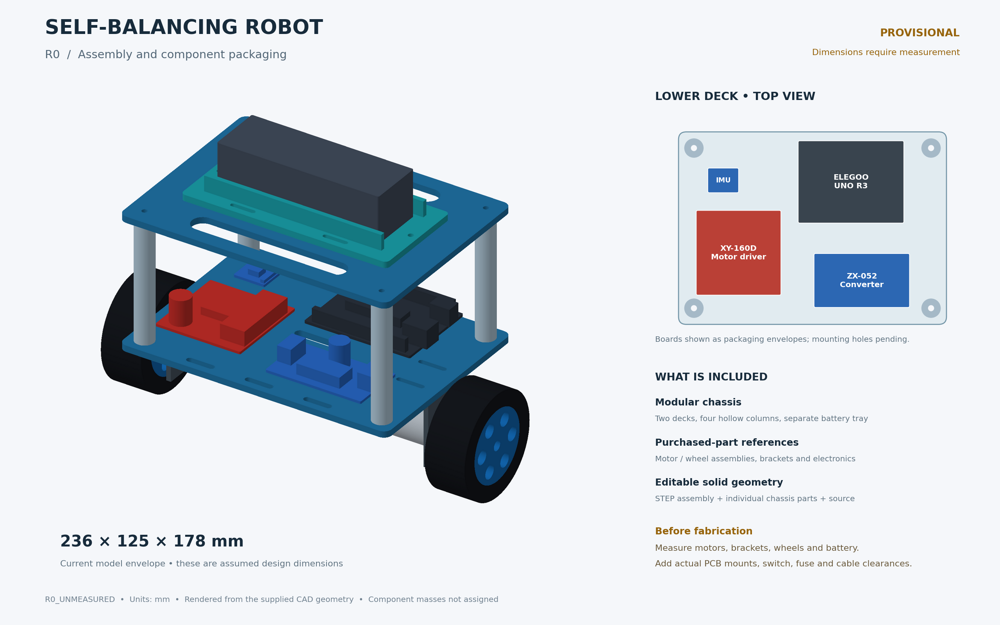

# Two-Wheel Self-Balancing Robot

Part of **Vehicle Dynamics Laboratory → Motion Control**.

A two-wheel inverted-pendulum robot, built to learn embedded motion control through a full model → predict → test → validate loop. The plan is to derive and simulate the plant in MATLAB/Simulink, implement PID and then LQR on hardware, and compare simulation against measured behaviour with quantitative metrics.


*R0 packaging concept. All dimensions are assumed and still have to be measured.*

## Status

| Phase | State |
|---|---|
| Component identification | ✅ Main parts identified (see [BOM](docs/BOM.md)) |
| Component characterization | 🟡 In progress: motor manual checks done, encoder signal test pending |
| CAD / chassis | 🟡 R0 concept done; R1 waits on measured dimensions |
| Wiring & schematic | ⬜ Draft architecture only ([docs/electrical.md](docs/electrical.md)) |
| Plant model & simulation | ⬜ Not started |
| PID balance | ⬜ |
| LQR balance | ⬜ |
| Sim-vs-hardware validation | ⬜ |

## Hardware

| Function | Part |
|---|---|
| MCU | Elegoo UNO R3 (ATmega328P) |
| IMU | MPU-6050 (GY-521) |
| Motor driver | XY-160D dual H-bridge |
| Logic supply | ZX-052 adjustable buck converter |
| Drive | 2× 25 mm geared DC motor with Hall quadrature encoder |
| Battery | LiPo (3S, to confirm), T-plug, inline fuse, switch |

## Control roadmap

1. **Model:** wheeled inverted-pendulum equations of motion, linearization about upright, open-loop poles.
2. **Estimation:** IMU pitch from a complementary filter, then a Kalman filter. Bias and noise characterization.
3. **PID:** pitch loop, then a cascaded wheel-velocity/position loop.
4. **System ID:** motor step tests, encoder scaling, model update with uncertainty.
5. **LQR:** full-state feedback on [x, ẋ, φ, φ̇]; compared with PID on identical disturbance tests.
6. **Stretch goals:** observer/LQG, MPC.

Each experiment reports prediction vs. measurement, with metrics (overshoot, settling time, steady-state error, noise, sample rate) and an explanation of any discrepancies.

## Folder layout

```
Self_Balancing_Robot/
├── docs/                 BOM, electrical architecture, build log
├── hardware/
│   ├── cad/              SolidWorks source, STEP, STL
│   └── electronics/      schematic, wire table
├── firmware/             UNO firmware (Arduino / PlatformIO)
├── modeling/             EOM derivation, linearization, controller design, simulation
├── data/                 logged test runs + analysis scripts
└── media/                photos, renders, videos
```
