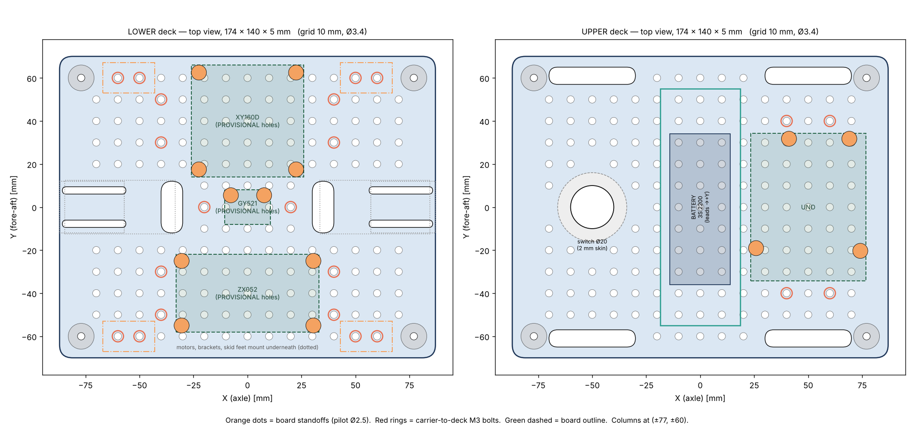
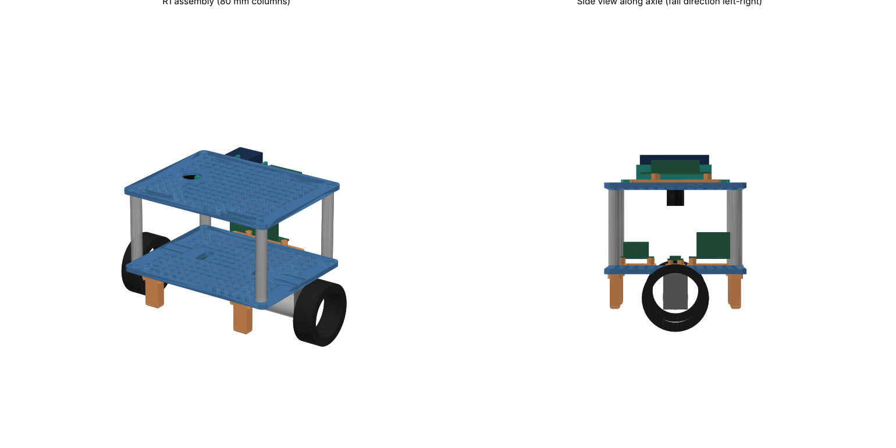

# Chassis R1: Self-Balancing Robot

R1 is the first chassis built from measured parts. It replaces the ChatGPT R0 concept, whose motor slots and battery tray didn't fit the real hardware.




## Concept
- **Two 174 × 140 × 5 mm decks** joined by 4 columns at (±77, ±60).
- **Both decks carry a 10 mm grid of Ø3.4 (M3) holes.** Every board sits on its own small **carrier** that bolts to the grid. If a board's holes are wrong, you reprint a 10-minute carrier, not a deck. The grid also lets you move the battery fore/aft to trim the CoM, and gives zip-tie anchors everywhere.
- **Lower deck:** XY-160D driver (front), MPU-6050 IMU (centre, on the axle line), ZX-052 buck (back). Motors and brackets mount **underneath**, on slots, so you can adjust the track width. Encoder cables come up through the two vertical slots.
- **Upper deck:** battery tray (centre, lead end at +Y), UNO (+X side, USB facing −Y), power switch (−X side, snap-in to a 2 mm skin). The fuse holder zip-ties to the grid.
- **4 skid feet** under the lower-deck corners stop a fall at **20°** and double as a rest stand.

Frame: X = axle, Y = fore-aft (the fall direction), Z = up. Origin = deck centre.

## Key dimensions (from `params.py`)
| | |
|---|---|
| Lower deck underside above ground | 55 mm (axle 32.5 + 22.5; **confirm** the flange-to-shaft-centre distance) |
| Columns | Ø12, M3 pilot bore, lengths **60 / 80 / 100** (80 = default; use the others to vary CoM height) |
| Track width (wheel centres) / overall width | 216 / 238 mm |
| Battery pocket | 31 × 73 mm, 15 mm rails, strap grooves underneath, end stop at −Y |
| Switch hole | Ø20.0 in a 2 mm skin (counterbored from below) |

## Status of each part
| File | Qty | Status |
|---|---|---|
| `01_lower_deck` | 1 | Ready |
| `02_upper_deck` | 1 | Ready (STL is flipped; print **top face down**) |
| `03_column_L60/80/100` | 4 each (print at least the 80s) | Ready |
| `04_battery_tray` | 1 | Ready (battery 70 × 28 × 25 measured) |
| `05_carrier_uno` | 1 | Ready (standard UNO hole pattern) |
| `06_carrier_xy160d` | 1 | **PROVISIONAL holes**: measure the board, then update `params.py` |
| `07_carrier_zx052` | 1 | **PROVISIONAL holes** |
| `08_carrier_gy521_imu` | 1 | **PROVISIONAL holes** |
| `09_skid_foot` | 4 | Ready (STL flipped: plate on the bed) |

## Print settings (Bambu H2D/H2C, ABS)
- Bambu ABS profile, **Textured PEI** plate with glue stick, door closed. Ventilate the room (ABS fumes).
- Layer 0.2 mm. **Brim 5 mm on the decks** (large flat ABS parts tend to warp at the corners).
- Decks: 4 walls, 30 % gyroid. Tray and carriers: 4 walls, 40 %. **Columns: upright, 6 walls** (effectively solid). **Feet: 5 walls, 50 %**.
- Print the **test coupons first** (15 min). If the M3 or switch holes don't fit, change `M3_CLEAR` / `M3_PILOT` / `SWITCH_HOLE` in `params.py` and regenerate.
- Solid-volume reference: decks ~110 cm³ each. Printed at the settings above, the whole set comes to roughly 200–250 g of ABS.

## Fasteners (M3 throughout)
| Use | Qty | Fastener |
|---|---|---|
| Columns ↔ decks (self-tap into column bore) | 8 | M3 × 12 |
| Motor brackets → lower deck (screw from top, nut under flange) | 8 | M3 × 12 + nut + washer |
| Carriers → decks (nut under deck) | 14 | M3 × 12 + nut |
| Battery tray → upper deck (nut under deck) | 4 | M3 × 12 + nut |
| Boards → carrier standoffs (self-tap) | 14 | M3 × 8 (M2.5 × 8 for the GY-521 if M3 is too tight) |
| Skid feet (screw from top, self-tap into foot) | 8 | M3 × 10 |
| **Total** | | **34 × M3×12, 8 × M3×10, 14 × M3×8, 26 nuts, 8 washers** |

An M3 socket-head assortment (6–20 mm, with nuts and washers) covers all of it.

## Assembly order
1. Brackets + motors under the lower deck (screws through the slots; set the track width, keep the wheels parallel).
2. Skid feet under the lower deck.
3. Carriers onto the lower deck, then the boards onto the carriers.
4. Columns onto the lower deck (screws from below).
5. Switch into the upper deck; tray and UNO carrier onto the upper deck.
6. Upper deck onto the columns (screws from the top). Route wires through the upper-deck slots.
7. Battery in the tray with a velcro strap through the grooves.

## Editing / regenerating
`src/params.py` holds every dimension. After changing it:
```bash
pip install cadquery          # once
python src/build_r1.py out    # STEP + STL + assembly + summary
python src/check_r1.py out    # interference check + 3D render
python src/layout_r1.py out   # deck top-view drawing
```
STEP files open in SolidWorks as solid bodies, in assembly orientation. `R1_assembly.step` includes simple stand-ins for the motors, wheels, boards and battery.

## Open items
- Measure XY-160D / ZX-052 / GY-521 hole spacing → update `BOARDS` in `params.py` → reprint those carriers.
- Confirm the bracket flange-to-shaft-centre distance (`AXLE_BELOW_DECK`). It sets the deck height and the skid-foot length.
- Test-coupon results → `M3_CLEAR`, `M3_PILOT`, `SWITCH_HOLE`.
